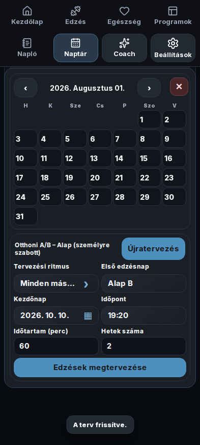
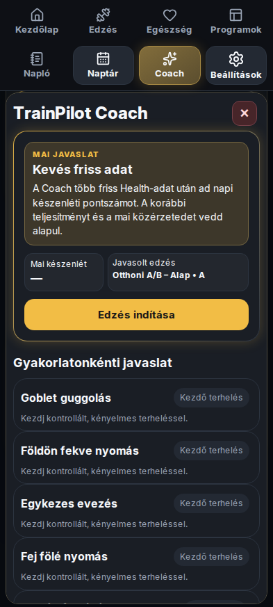

# TrainPilot

Edzéstervezés és naplózás Androidon és Wear OS-en, opcionális egészségadatokkal, regenerációs ajánlással, GPS-útvonallal és Google-szinkronnal.

[English](README.md) · [Kiadásjegyzék](docs/releases/INDEX.md) · [Aktuális munkaátadás](docs/WORK_HANDOFF.md)

## Letöltés és aktuális forrás

Jóváhagyott kiadásjelölt: **1.3.71 /2735**, #234. Main-egyesítés és publikálás a telefonos/órás kapuk sikeres lefutása után. [Kiadási jegyzet](docs/releases/v1.3.71.md).

| Stabil kiadás, ellenőrizve: 2026. október 20. | Verzió | Forrás |
| --- | --- | --- |
| Közzétett APK: [telefon](https://github.com/fuloplevente1998/TrainPilot/releases/tag/v1.3.7) és [Wear OS](https://github.com/fuloplevente1998/TrainPilot/releases/tag/wear-v1.3.7) | **1.3.7 /2734** | #230 main-egyesítés `8a58f3a`, mindkét független aláírt Release Gate sikeres. |
| Korábbi közzétett verzió | 1.3.6 /2733 | [Történeti kiadási jegyzetek](docs/releases/v1.3.6.md). |

Az 1.3.7 tartalmazza a korábban elfogadott Samsung/Coach-javításokat, a Napló-alapú automatikus súly- és ismétlés-előtöltést (tervezett és gyors edzés), a PR-jelvényt, a sorozathaptikát és a tényleges sorozatonkénti RIR-t. Részletek: [kiadási jegyzet](docs/releases/v1.3.7.md) · [repository-takarítás szabályzata](docs/REPOSITORY_CLEANUP_POLICY.md).

A telefonos APK a telefonra, a Wear APK az órára való. Frissítéskor őrizd meg az alkalmazás adatait. A forrás, ellenőrzőösszeg és buildadat mindig az adott kiadáshoz tartozik; régi verzió választása előtt nézd meg a [jegyzéket](docs/releases/INDEX.md). A Play-megjelenés előkészítése a [#214](https://github.com/fuloplevente1998/TrainPilot/issues/214) része.

## Az elfogadott main fő funkciói

- Saját programok, gyors edzés, gyakorlatkönyvtár, sorozat-/ismétlés-/súlyrögzítés, időzítők, Napló és fejlődés.
- Normál/HIT-inspirált stílus, dupla/lineáris/RIR progresszió, előnézet, jóváhagyás és visszavonás; tényleges sorozatonkénti RIR-bevitel.
- Dátumozott, forrással jelölt regeneráció: mai hiteles Samsung-pontszám esetén automatikusan az az alap, hiánynál a TrainPilot saját becslése. A fájdalom/terhelés korlátai megmaradnak.
- Health Connect vagy közvetlen Samsung Health import, tartós helyi egészségnapló, külön TrainPilot Wear-mérési forrás.
- Telefon–óra vezérlés, automata munka/pihenő, visszaigazolt átadás, önálló/offline órás edzés, Mini napló, Tile és számlapi kiegészítő.
- Opcionális GPS-távolság és privát útvonal; GPS nélküli beltéri intervallumok.
- Helyi JSON/ZIP-mentés, privát edzésfotók, opcionális Drive `appDataFolder` és Google Naptár.
- Több nyelv, témák és rendszerbetűméret-támogatás.

A szolgáltatói adat elérhetősége a készüléktől, engedélyektől és tényleges megosztástól függ. A saját készülékes Samsung-siker nem bizonyítja a nyilvános production partner-hozzáférést. [Play-előkészítés](docs/PLAY_STORE_CHECKLIST_2026.md).

## Felületi példák

| Naptár és tervezés | Coach nagyobb rendszerbetűvel |
| --- | --- |
|  |  |

Szintetikus Chromium-tesztadatok az elfogadott forrásból; nem személyes egészségadat vagy natív készülékes bizonyíték. [Eredet](docs/screenshots/README.md).

## Dokumentáció és fejlesztés

- [Változások: 1.0, 1.1, 1.2, 1.3](RELEASE_NOTES.md)
- [Kiadásjegyzék](docs/releases/INDEX.md), [verziószabály](docs/VERSION_POLICY.md)
- [Build/aláírás](docs/BUILD.md), [Wear OS](docs/WEAR_OS.md)
- [UI-ellenőrzés](docs/UI_TESTS.md), [teljesítmény](docs/PERFORMANCE_REGRESSION_POLICY.md)
- [Play-előkészítés](docs/PLAY_STORE_CHECKLIST_2026.md), [adatvédelmi tervezet](docs/PRIVACY_POLICY_DRAFT.md)
- [Aktuális átadás](docs/WORK_HANDOFF.md), [#214 karbantartás](docs/MAINTENANCE_214.md)

```bash
npm ci
node scripts/check-version-policy.cjs
node --test scripts/check-version-policy.test.cjs scripts/release-metadata.test.cjs
npm test
npm run test:ui
```

Teljes Chromium, natív release és aláírt APK GitHub Actionsben készül, külön telefonos/órás kapuval. Fejlesztés külön ágon és Draft PR-on; alkalmazásváltozáshoz pontos forrású ellenőrzés és felhasználói elfogadás kell. [Munkarend](AGENTS.md).

A Google-integrációkhoz külön OAuth-beállítás kell. Aláírókulcs, credential és személyes mentés nem kerülhet a repóba. A `npm run sync` a generált Android-projektet is módosítja; ezeket commit előtt felül kell vizsgálni.

## Licenc

A TrainPilot zárt/proprietary alkalmazás; a csomag `private` és `UNLICENSED`. A publikus forrás nem ad nyílt forrású licencengedélyt. A kereskedelmi/terjesztési feltételek véglegesítése külön #214 feladat. A külső összetevők saját licencei megmaradnak, köztük a [Lucide licence](www/LUCIDE-LICENSE.txt).
