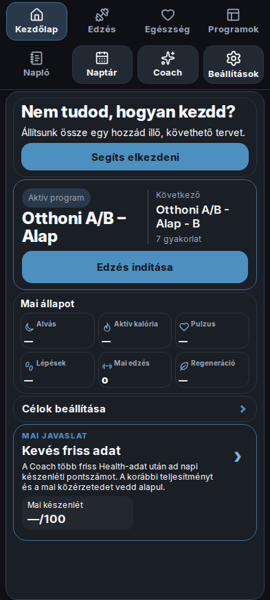
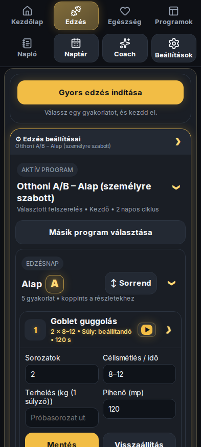
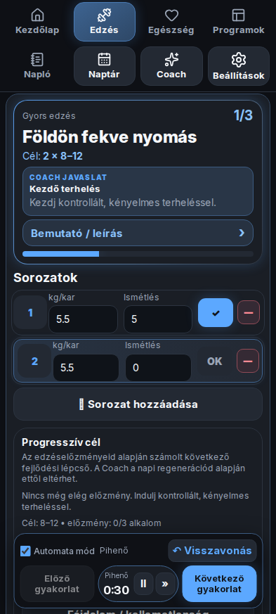
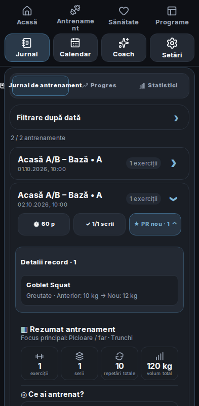
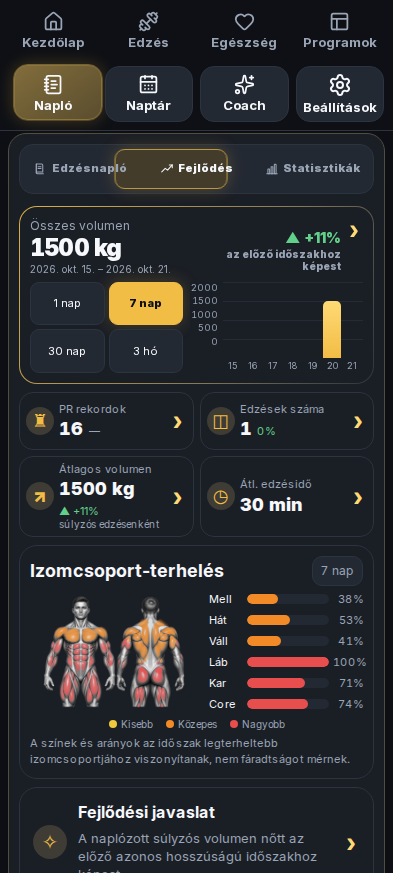
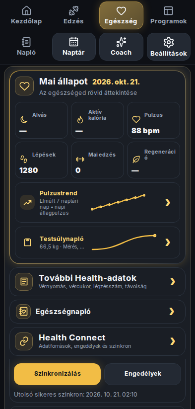
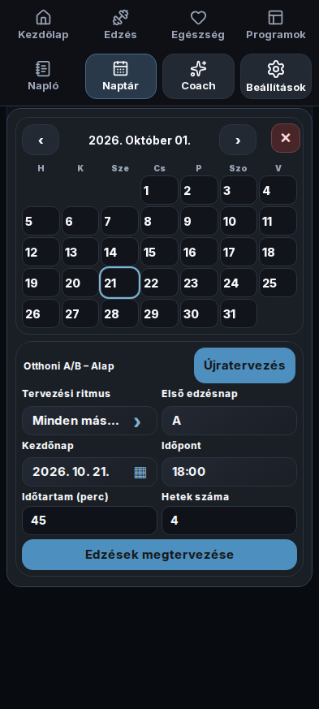
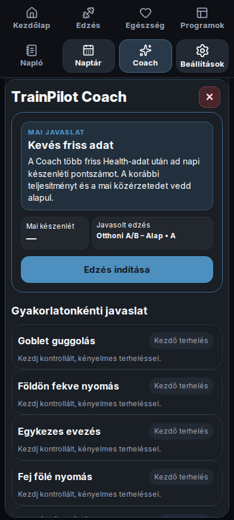
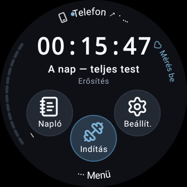
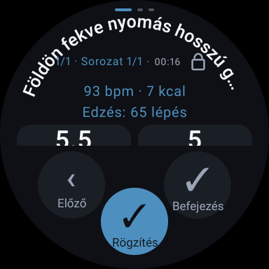

# TrainPilot

Workout planning and logging for Android and Wear OS, with optional health data, recovery guidance, GPS routes and Google sync.

[Magyar leírás](README.hu.md) · [Release catalog](docs/releases/INDEX.md) · [Current handoff](docs/WORK_HANDOFF.md)

## Downloads and source status

| Latest stable release | Version | Source |
| --- | --- | --- |
| [Phone](https://github.com/fuloplevente1998/TrainPilot/releases/tag/v1.3.71-perf-20261022) and [Wear OS](https://github.com/fuloplevente1998/TrainPilot/releases/tag/wear-v1.3.71-perf-20261022) | **1.3.71 /2735**, performance build, 2026-10-22 | Device-accepted #235/#237, main `5d27aa9c5ebf68d1c206c88a74dea89e660a4937`. Separate release labels preserve the original 1.3.71 binaries. |
| Previous published release | 1.3.7 /2734 | [Historical release notes](docs/releases/v1.3.7.md). |

The updated 1.3.71 build improves startup, bounds the initial Journal list, synchronizes navigation color with page changes and includes an optimized smaller phone APK. The startup/navigation slowdown fix was accepted on device. Earlier PR details, Cancel, haptics, automatic set prefilling, actual RIR and Samsung/Coach features are retained. See [release notes](docs/releases/v1.3.71-perf-20261022.md).

Install the phone APK on the phone and the Wear APK on the watch. Preserve the existing application data when updating. APKs, source archives, checksums and build metadata belong to their specific release; check the [catalog](docs/releases/INDEX.md) before choosing an older build. Google Play publication is still being prepared in [#214](https://github.com/fuloplevente1998/TrainPilot/issues/214).

## App features

| Area | Included features |
| --- | --- |
| Planning | Personal and profile-assisted programs, editable program days, exercise library, quick workouts, calendar scheduling, goals and replanning missed sessions. |
| Strength training | Sets, repetitions and weights; automatic prefill from the latest matching completed exercise; normal/HIT styles; double, linear and RIR/Coach progression. |
| During a workout | Work/rest timers, automatic phases, optional sound/haptics, set undo and actual 0–10 RIR per set. |
| History and progress | Workout diary, personal-record badges with expandable details, volume and cardio statistics, estimated 1RM, muscle-group workload and private workout photos. |
| Health and recovery | Health Connect or Samsung Health import, local health journal, source-labelled measurements and recovery/Coach guidance; current Samsung Energy Score when available. |
| Distance and intervals | Phone or watch GPS recording, private routes displayed on the phone, indoor timing without GPS and explicit measurement completion without an extra set confirmation. |
| Wear OS | Planned/quick and offline workouts, phone/watch control and acknowledged handoff, supported Health Services measurements, Mini diary, Tile, complication, crown/bezel editing and touch lock. |
| Backup and sync | Local JSON/ZIP backups, optional Google Drive app-data sync and Google Calendar integration. |
| Personalisation | HU/EN/DE/RO interface, themes, larger system text and configurable training/rest feedback. |

[Detailed feature guide in Hungarian](docs/FEATURES.hu.md).

Availability depends on the device, provider, permissions and data actually shared. Successful Samsung reading on the accepted device does not establish production partner access for every installation. See the [Play preparation checklist](docs/PLAY_STORE_CHECKLIST_2026.md).

## Screenshots

| Home | Program day |
| --- | --- |
|  |  |

| Active workout and automatic rest | Personal-record details (Romanian interface) |
| --- | --- |
|  |  |

| Progress and muscle-group workload | Health overview |
| --- | --- |
|  |  |

| Calendar and planning | Coach guidance |
| --- | --- |
|  |  |

| Wear OS home | Wear OS active workout |
| --- | --- |
|  |  |

Unmodified captures from the 1.3.71 source: shared phone UI in Chromium and native Wear UI on a round emulator. They use synthetic fixtures and demonstrate several themes/languages. They are not personal health records or approved Play listing device photos. [Provenance and full-size images](docs/screenshots/README.md).

## Documentation

- [Changes by version family: 1.0, 1.1, 1.2, 1.3](RELEASE_NOTES.md)
- [Release catalog and immutable build history](docs/releases/INDEX.md)
- [Version and release policy](docs/VERSION_POLICY.md)
- [Build and signing](docs/BUILD.md), [Wear OS](docs/WEAR_OS.md)
- [UI validation](docs/UI_TESTS.md), [performance policy](docs/PERFORMANCE_REGRESSION_POLICY.md)
- [Play preparation](docs/PLAY_STORE_CHECKLIST_2026.md), [privacy draft](docs/PRIVACY_POLICY_DRAFT.md)
- [Current handoff](docs/WORK_HANDOFF.md), [maintenance scope](docs/MAINTENANCE_214.md)

## Development

```bash
npm ci
node scripts/check-version-policy.cjs
node --test scripts/check-version-policy.test.cjs scripts/release-metadata.test.cjs
npm test
npm run test:ui
```

Full Chromium, native release and signed APK validation runs in GitHub Actions. Phone and Wear have separate release gates. Application changes need source-matched evidence and user acceptance; work starts on a development branch and Draft PR. See [AGENTS.md](AGENTS.md).

Google integrations require separate OAuth configuration. Signing keys, credentials and personal backups must stay outside the repository. `npm run sync` updates Capacitor's Android project and should be reviewed before committing generated files.

## License

TrainPilot is proprietary. The package is marked `private` and `UNLICENSED`; public source visibility does not grant an open-source license. Distribution/commercial terms remain a separate decision in #214. Third-party components retain their own licenses, including the [Lucide license](www/LUCIDE-LICENSE.txt).
