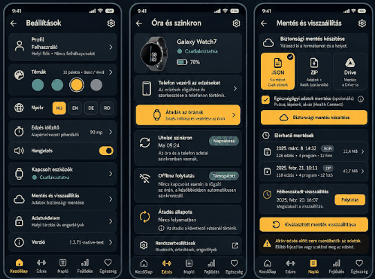
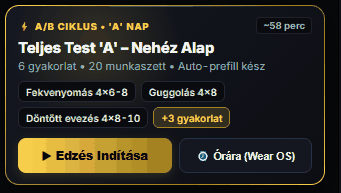
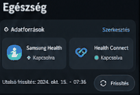
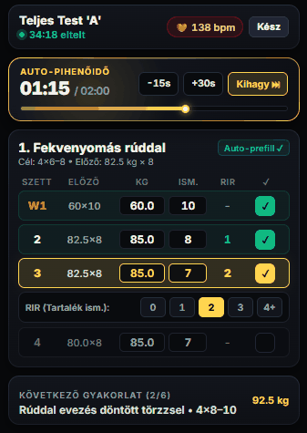
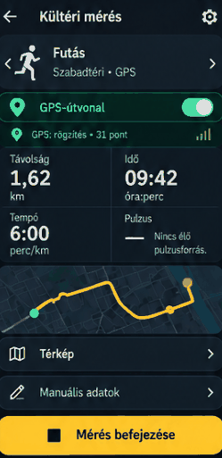
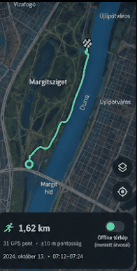
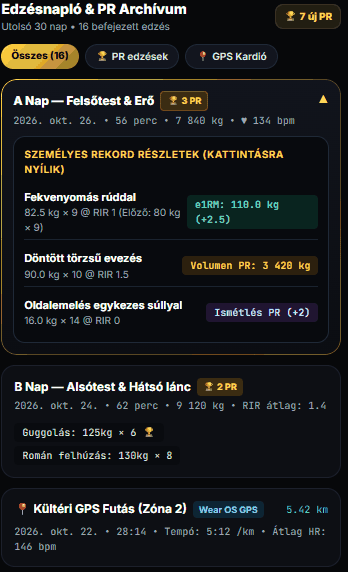
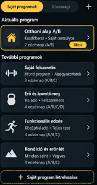

# TrainPilot – UI/UX referenciaképek (2026-10-29)

A részletes, magyar nyelvű agent-specifikáció: [IMPLEMENTATION_PLAN.md](../IMPLEMENTATION_PLAN.md).

**Kiindulás:** `main` (`8a36502da5832a42f1cb91708ecfed5cf4f9ed62`); **nem** a különálló PR #271. A képek nem pixelpontos színpaletta-előírások. Az aktuális TrainPilot témaszín, fő navigáció és minden működő funkció marad. A PNG-k méretoptimalizált, 128 színre konvertált képmásolatok; a részletezett elrendezést/UX-ötleteket szemléltetik, az eredeti képek a beszélgetés mellékletei.

## 1. Beállítások

## 2. Edzés indítása / Wear OS

## 3. Egészség / kapcsolat (opcionális)

## 4. Aktív edzés

## 5. Kültéri mérés

## 6. Teljes képernyős térkép

## 7. Napló és PR archívum

## 8. Programok

**Agent-feladat:** mielőtt módosítasz, ellenőrizd a tényleges jelenlegi képernyőket/állapotot a main-derived branchen. Ne másolj vissza #271-es kísérleti navigációt. Dokumentáció-only PR; a UI/UX változtatásokat külön commitokban, tesztekkel kell megvalósítani.
