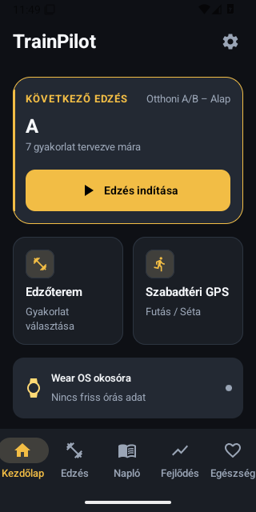
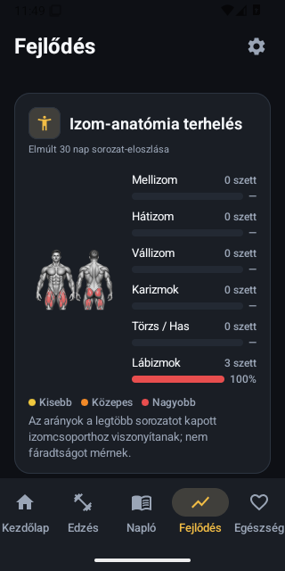

# Első P1 natív előnézet – 4af5ff2d

Valódi, módosítatlan Android-emulátoros PNG-k (`adb exec-out screencap -p`).
Forrás: 4af5ff2dc047b61320f061ce77b6c9268eae82d4.
Futás: https://github.com/fuloplevente1998/TrainPilot/actions/runs/40497708263
Artifact:12731553607. Sárga mentett téma; **izolált, szintetikus tesztadatok**.
A képek eredeti méretben és bájtokkal, az artifact manifestjének SHA-256 hashével egyeznek.

**Köztes állapot, nem végleges vizuális vagy funkcionális elfogadás.**
Ebben a futásban 1333 JVM PASS, 115/116 phoneUI PASS, nincs hiányzó teszt/runnercrash.
Egy locale-eset a Training elhagyott Quick csoportcímén hibázott, javítása folyamatban.
A Wear1 infrastruktúrahiba: rendszerkép-letöltés Premature EOF még az app indítása előtt.

## Kezdőlap

## Fejlődés – eredeti main anatómiai assetekkel

Az izomtérkép a meglévő natív read-model sorozateloszlását jeleníti meg;
nem fáradtság- vagy orvosi mérés. A main teljes volume/PR/interaktív részletei,
a Health pulse/weight accordions és a többi P1 nyitott pont még feladat.
