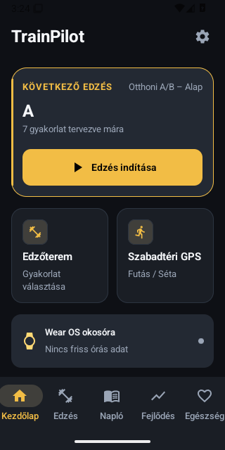
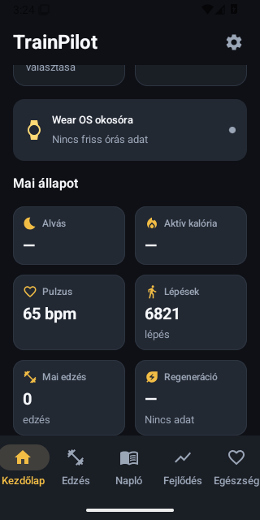
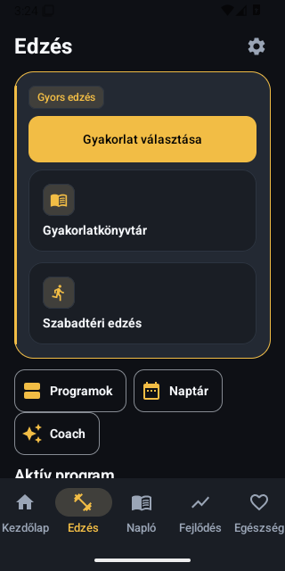
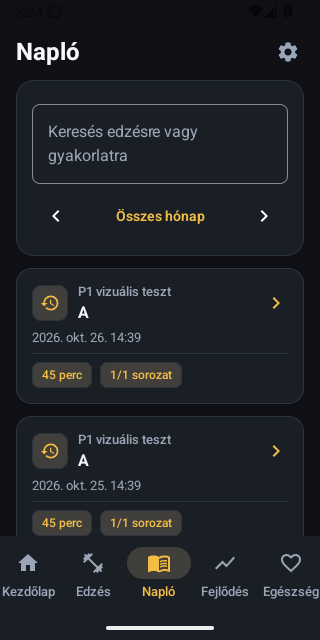
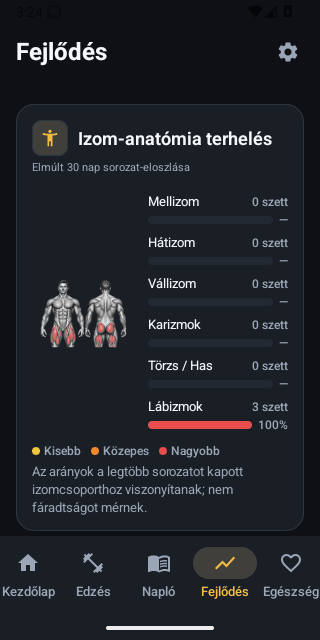
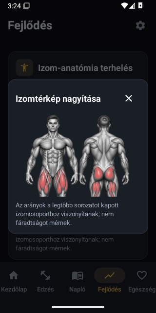
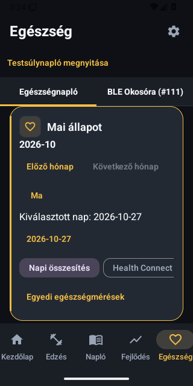
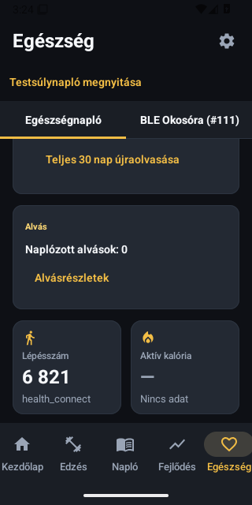

# Zöld P1 baseline – a Studio bevezetése ELŐTT

Valódi, változatlan adb-emulátorképek, izolált szintetikus tesztadatokkal.
Nem végleges dizájn; itt még a korábbi alsó navigáció látható.
A felhasználó új döntése felső ötfüles navigáció, a PR270 építi be.

Forrás: f0c474f17072aaf6f5c23506e0ad5b1c0092e2ae.
Futás: https://github.com/fuloplevente1998/TrainPilot/actions/runs/40529220611
Phone artifact12746356640,117/117PASS,0missing/crash/skip.
1333JVM+183Wear PASS;2signedupgradeSUCCESS.65PNG hash/size/PIL-verify ellenőrizve.

## p1_home

## p1_home_metrics

## p1_training

## p1_journal

## p1_progress

## p1_anatomy_zoom

## p1_health

## p1_health_metrics

