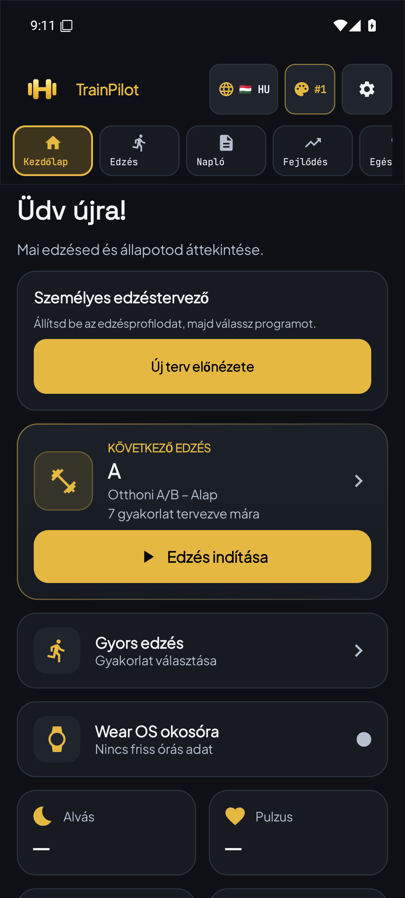
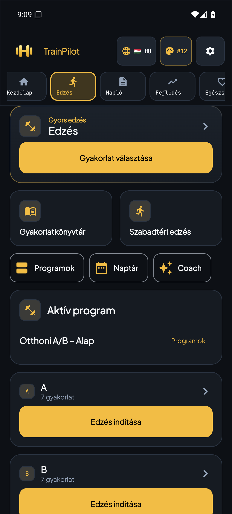
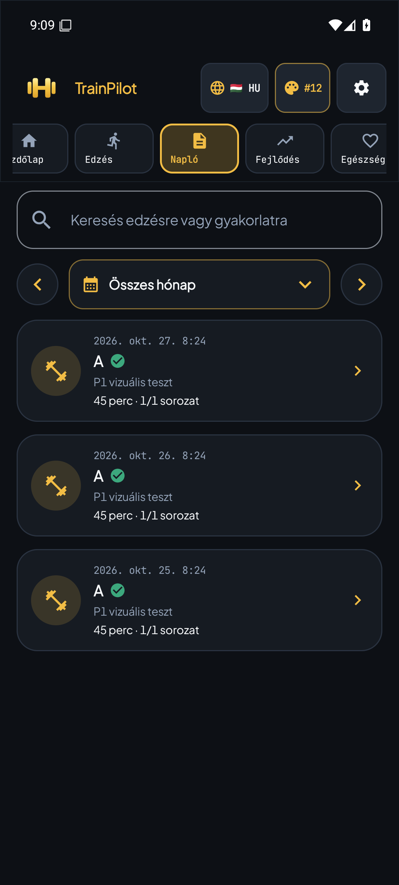
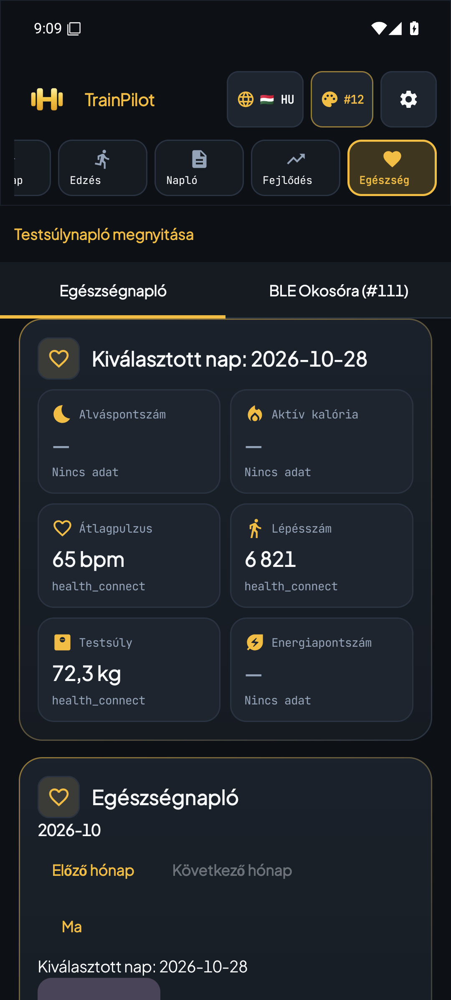
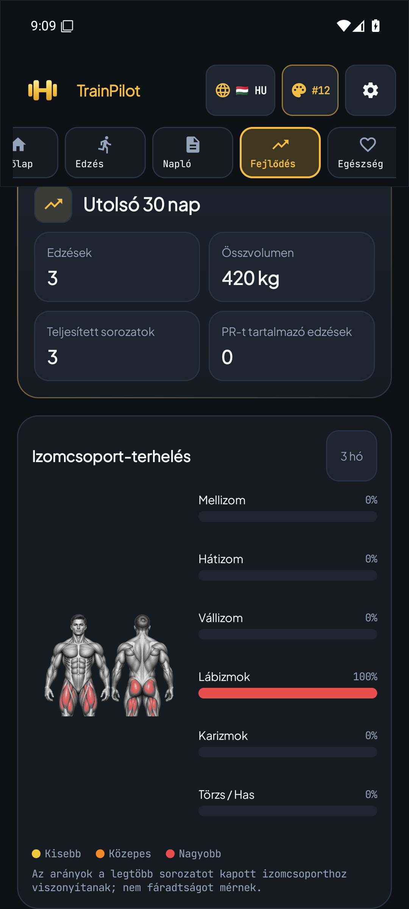
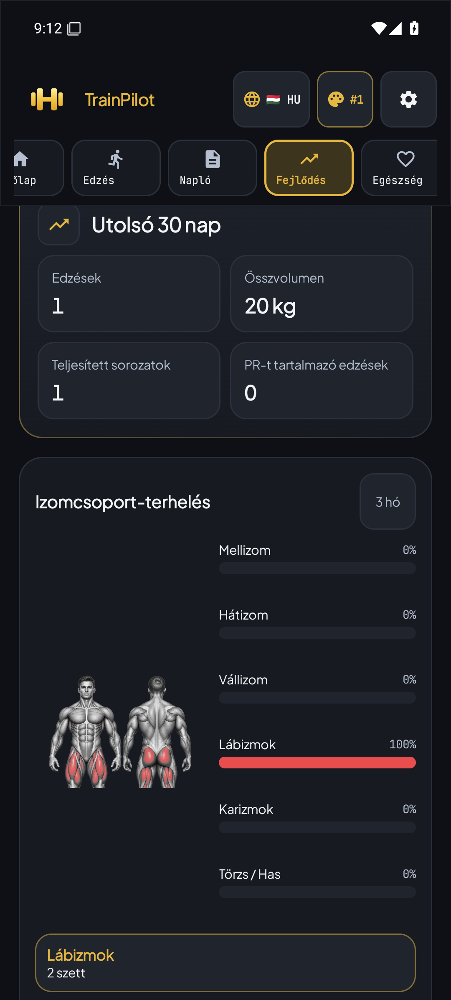
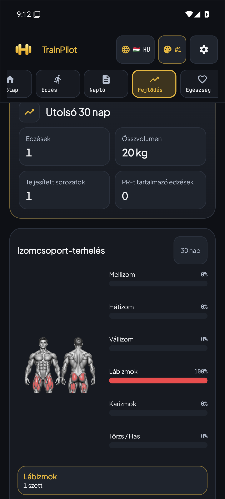

# Natív TrainPilot – telefonprofilos képek, a27cc2fe

**Köztes natív állapot; a teljes Studio-megjelenés még nincs kész.**
A [Drive-képek az elsődleges vizuális célok](../../STUDIO_DRIVE_VISUAL_REFERENCE_2026-10-28.md).

Forrás: `a27cc2fe674dd7a707bb0f2f6590fd1ef74f6f5d`.
[GitHub Actions #40660277579](https://github.com/fuloplevente1998/TrainPilot/actions/runs/40660277579)
7/7 job SUCCESS. Nyers XML/instrumentáció külön ellenőrizve: **1344 unit,
123 telefonos (119 + 4 GPS), 183 Wear teszt PASS**; nulla failure/error/skip,
nulla missing/runner-crash. Mindkét aláírt régi→natív adatfrissítési próba SUCCESS.

Profil: **1080×2392 px / 450 logikai dpi / 384 dp szélesség / 90% betűméret**,
API 35, Pixel 7 alapú Android emulátor. Ez a felhasználó méretezése, nem Xiaomi
rendszerkép vagy fizikai Redmi készülékes próba. A runner a valós wm/fontScale
értékeket visszaolvasta. A disposable emulátor idegen NexusLauncherét az app
indítása előtt letiltotta; az alkalmazás fókusz- és crash-ellenőrzése megmaradt.

Az alábbi PNG-k az eredeti `adb exec-out screencap -p` byte-ok, átméretezés,
vágás vagy utómunka nélkül. A teljes artifact 71 képének mérete, SHA256 hash-e,
byte-száma és dekódolhatósága ellenőrizve. A megjelenített adatok izolált
emulátoros tesztadatok; nem felhasználói egészség-/fiókadatok.

[Gépi bizonyíték és képindex](evidence.json) ·
[Teljes telefonos artifact](https://github.com/fuloplevente1998/TrainPilot/actions/runs/40660277579/artifacts/12804148382)

A Home és az izomkártya #1 Graphite/Gold témát használ. A többi P1-kép a meglévő
regressziós próba #12 sárga témája. Különböző témák között nem állítunk pontos
színegyezést; a Home #1 képen is láthatók a dokumentált felületeltérések.

## Kezdőlap, Graphite/Gold #1

SHA256 `f767239fd8d70522d6dfa90c98ef6458f44abc15be1a785bba526e88e2c61da8`

## Edzés, sárga #12

SHA256 `764f1c4a5f8b873af7a057d789f9ce8a723973d5faecfba51cf8928153ec56a8`

## Napló, sárga #12

SHA256 `e5e9e3a2c5e415b6a9b79eca9cb4a6882edaf5960f004ae6cb307077b98f9b6c`

## Egészség, sárga #12

SHA256 `4e80f8a4f29ec11039d5eb0239a2d6f7040e92f62f0841dc033e5a58a4bce737`

## Fejlődés, sárga #12

SHA256 `b353e2694cc4ccaa260224585b08c74dba60bf2df860e73f6922765b72e3f234`

## Izomterhelés, 3 hónap / 2 sorozat

SHA256 `a59d9e47bfa79a61e595e928859e446e31ccf95b0df24f502dbc26d7d895d5c6`

## Izomterhelés, 30 nap / 1 sorozat

SHA256 `dd56a4542fd69331a94433d328699434354173b8ce73072ec134585c3ee0c922`
