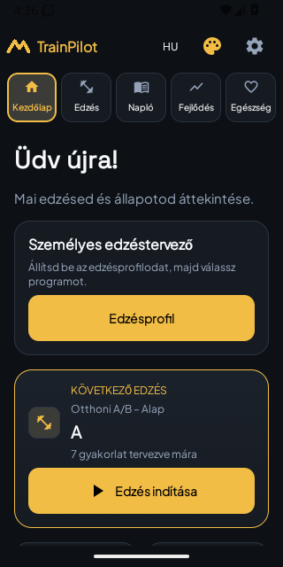
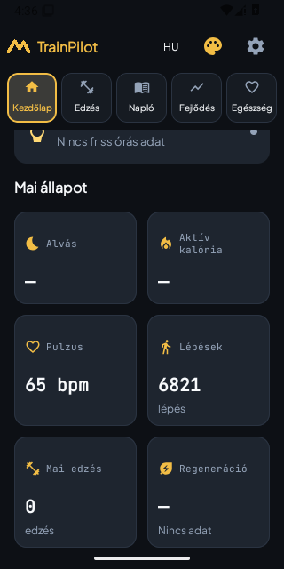

# Első valódi Studio-increment – köztes natív képek

Változatlan adb-emulátorképek, sárga mentett témával és izolált szintetikus adatokkal.
Nem generált mockup, nem a teljes StudioUI és nem vizuális elfogadás.
Forrás0fb350a47b1c17a04851ce6a0f7529f510dad8d9, Actions40539957380,
phoneartifact12750939854.65PNG manifestSHA256/PIL-verify Rootellenőrizve.
1333JVM és3Wear+2signedupgradeSUCCESS; phone116/118,2FAIL/0missing/crash.
Home/profile/header-entry és a gold5oldal/anatomy regresszió PASS.
A2FAIL: font2német fül címkéje és örökléselőnézetteszt. A két javítás457dc1e6,
és a képen alacsonykontrasztú rendszerikonok javításab80ebc62 után új gate kell.
A korábbi galériák még Studio ELŐTTI állapotok; itt a Studio fontok/header/Home már látszanak.

## p1_home

SHA256 `23fde3f053cb490d25aef95107b6d5ce89d34c3e3a01c844e72fc5f8f39952fe`

## p1_home_metrics

SHA256 `4428df850e0298530055716d716950db02690bd6123ef0c92d96f3a794878c51`

