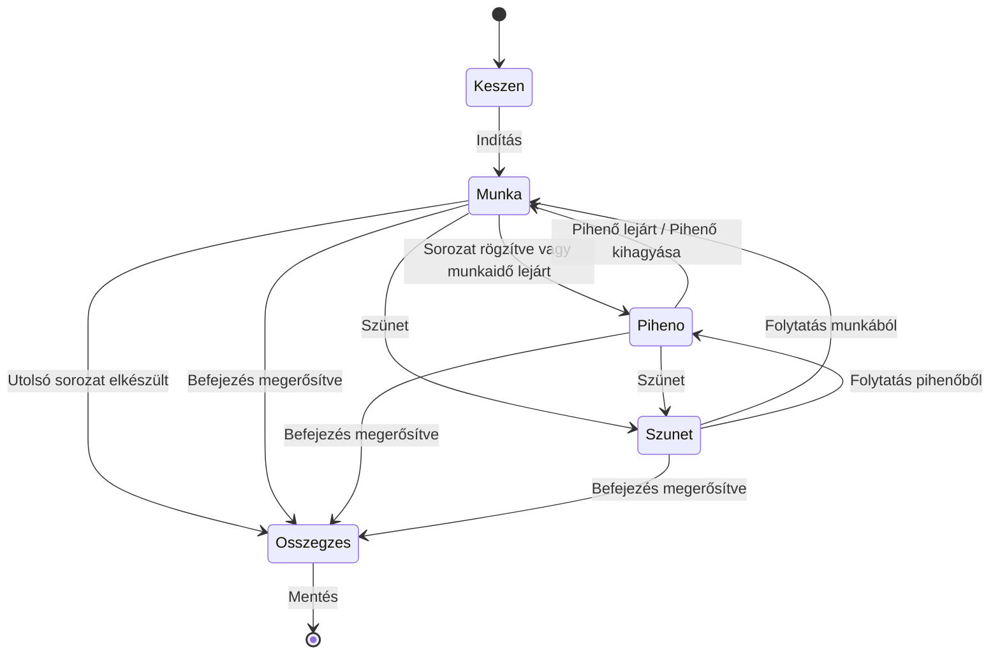

# Telefonos és Wear OS automata mód, Wear UI-fejlesztési terv

Frissítve: 2026. október 12. Állapot: közös munkaterv, nem kész funkciók listája.

Ez az egy fájl fogja össze a **telefonos és órás automata mód közös tervét**, valamint a Wear OS UI- és funkcióötleteket. Az automata mód mindkét alkalmazás fejlesztési feladata. A következő döntéseket és pontosításokat is itt vezetjük tovább.

Kapcsolódások: [kezdőlap #170](https://github.com/fuloplevente1998/TrainPilot/issues/170), [Wear UI draft PR #178](https://github.com/fuloplevente1998/TrainPilot/pull/178), [automata mód #162](https://github.com/fuloplevente1998/TrainPilot/issues/162), [korábbi automata draft PR #164](https://github.com/fuloplevente1998/TrainPilot/pull/164), [későbbi térkép #163](https://github.com/fuloplevente1998/TrainPilot/issues/163).

## 1. Kiinduló állapot

- A #178-ban elkészült a telefonos ikonokat és témát követő kezdőlap, a külön Beállítások oldal, az aktív edzés közvetlen törlése megerősítéssel, a felfelé húzással nyitható menü és a Mini napló tördelése. Készülékes elfogadása még szükséges.
- Jóváhagyott kiegészítés: a gyakorlatoldalon a sorozatadatok mellett kis, halványabb `HH:mm` pontos idő. Egy sorban marad, súlyzós és időzített gyakorlatnál is; megvalósítása a #178 része.
- A #164 korábbi, készülékesen még nem elfogadott telefonos automata megoldás. Az új telefonos automata mód alapjaként az aktuális, elfogadott mainhez és az itt rögzített működéshez kell igazítani; az órás automata működéshez külön integráció szükséges. A #178 UI-build nem jelenti az automata mód elkészültét egyik alkalmazásban sem.
- A térkép a #163 külön folytatása. Az időzített futóintervallum és a meglévő GPS-mérés együttműködése már az automata mód része.

## 2. Wear OS-javaslatok és sorrend

A felhasználó ezeket felvette a tervbe; a lent javasolt részletszabályok még tervezési alapok.

| Sorrend | Fejlesztés | Tervezett működés | Elfogadás fő szempontja |
| --- | --- | --- | --- |
| 1 | Automata mód és pihenőjelzések | Munka/pihenő/sorozat/gyakorlat léptetése a 3. fejezet szerint; 3–2–1 előjelzés és külön indulási rezgés | Az óra lezárva is helyesen vezet végig, pontosan egyszer vált |
| 2 | Utolsó rögzítés visszavonása | Rögzítés után rövid ideig közvetlen Visszavonás; később az edzésmenüből is visszaérhető | A téves sorozat és a hozzá tartozó automatikus léptetés együtt visszaállítható |
| 3 | Érintészár edzés közben | Külön bekapcsolható védelem izzadság és ruha okozta érintések ellen; jól látható zárjel, hosszú nyomásos feloldás | Egy véletlen érintés nem rögzít, töröl vagy léptet; a feloldás egyértelmű |
| 4 | Lünetta/korona a szerkesztőben | A súly és ismétlés forgatással állítható a támogatott órákon; a plusz–mínusz és Mentés/Mégse is használható | Csak a megnyitott szerkesztő értéke változik, elfordítás nem ment magától |
| 5 | Kapcsolat és mentés állapotának finomítása | A már létező kapcsolatjelzés mellett világos „Órán mentve” / „Szinkronra vár” visszajelzés, szükség esetén újrapróbálás | Kapcsolatvesztéskor is érthető, hol van az edzés; nincs elveszett vagy kettős mentés |

UI-alapelv: a gyakorlatnév, aktuális szakasz és elsődleges művelet maradjon jól olvasható. Az új jelzések ne tolják le a gombokat; a kör alakú kijelző széle és a nagyított rendszerbetű is a terv része. A színek és ikonok a telefonos TrainPilothoz igazodjanak.

## 3. Automata mód — eldöntött működés

**Felhasználói döntés, 2026. október 12.: súlyzós, ismétléses edzésnél a felhasználó rögzíti a sorozatot; utána a pihenő és a következő sorozat indítása automatikus.**

Ez a szabály a telefonos és az órás alkalmazásban is érvényes, tervezett és gyors edzésnél egyaránt.

### Három támogatott használat

| Használat | Elvárt működés |
| --- | --- |
| Csak telefon, óra nélkül | Teljes automata mód: beállítás, rögzítés, pihenő, sorozat-/gyakorlatváltás, jelzések, szünet, folytatás és mentés a telefonon |
| Csak óra, telefonkapcsolat nélkül | A helyben elérhető edzéssel önálló órás automata működés; helyi megőrzés és későbbi szinkron |
| Telefon és óra együtt | Ugyanaz az edzésállapot mindkét felületen; rögzítés/szünet/folytatás bármelyikről, egyetlen irányított idővonallal |

### Telefonos automata mód — önálló fejlesztési rész

- Edzésindítás előtt bekapcsolható Automata mód, az edzés és a gyakorlat típusához illő beállításokkal. A meglévő munka-/pihenőidő és körszám használható, a választás elmenthető.
- Ismétléses edzésnél a telefonos Rögzítés indítja a pihenőt, a lejáró pihenő pedig a következő sorozatot vagy gyakorlatot. Az ismétlés és a súly tényleges adat marad.
- Időzített gyakorlatnál és futóintervallumnál a munka/pihenő automatikusan vált, a sorozat vagy kör állapota a megfelelő edzéshez kerül.
- A natív Android telefonos appban lezárt kijelző és háttérben levő app mellett is időzítsen, a beállított telefonos hang-/rezgésjelzéssel. Látható edzésértesítésből lehessen szüneteltetni, folytatni és leállítani.
- Óra nélkül is teljes értékűen használható legyen. A telefonos GPS-mérés együtt futhasson az intervallummal; helyengedély-hiány ne állítsa le az időzítőt.
- A telefonos piszkozat-visszaállítás, edzésváltás, kézi beavatkozás és végső mentés ugyanazokat az állapotvédelmeket kövesse, mint az órás működés.
- Böngészős használatnál a korábbi nyitott oldalas korlát érvényes; a lezárt kijelzős háttérműködés vállalása a natív Android alkalmazásra vonatkozik.

### Ismétléses / súlyzós edzés

1. A felhasználó elindítja az edzést, majd elvégzi a sorozatot.
2. Ellenőrzi vagy javítja a tényleges súlyt és ismétlést, és megnyomja a Rögzítés gombot.
3. Elindul a beállított pihenő. A kijelzőn a hátralévő idő és a következő sorozat/gyakorlat neve látszik.
4. A pihenő végén rezgés jelez, és újabb Start-koppintás nélkül a következő sorozat munkaszakasza lesz aktív.
5. Ha a gyakorlat összes sorozata elkészült, a következő gyakorlatra vált. A sorozat vége ott is a felhasználó tényleges rögzítése.
6. Az utolsó gyakorlat utolsó sorozata után az edzés összegzése következik; az edzés végső mentése tudatos művelet.

Az automatikus indulás készenléti/munkaszakaszt jelent. A pihenő lejárta nem rögzít magától ismétlést, súlyt vagy teljesített sorozatot. Az óra mozgásából történő automatikus ismétlésszámlálás külön, későbbi kutatási feladat lenne.

### Időre végzett gyakorlat

- Beállítható munkaidő, pihenő és ismétlődés/sorozatszám. Az aktív munkaidő lejáratakor a mért időt az adott sorozathoz rögzíti, majd pihenőre vált.
- A pihenő végén automatikusan indul a következő munkaszakasz. A gyakorlat utolsó sorozata után a következő gyakorlat következik.
- Ismétléses gyakorlatra érkezve az ismétléses szabály lép életbe: a sorozat végét a felhasználó rögzíti.
- Oldalankénti időzésnél a bal/jobb oldal sorrendjét és az esetleges oldalcserés pihenőt külön meg kell adni. Ez a korábbi #164-ben megállási pont volt; nem tekinthető kész támogatásnak.
- Nulla pihenőnél közvetlen átmenet legyen; az utolsó munkaszakasz után ne induljon felesleges záró pihenő.

### Futás / időalapú intervallum

Példa: **30 mp futás → 60 mp pihenő/lassú szakasz → következő kör**, nyolc körön át, újabb Start-koppintások nélkül.

- A munka, pihenő és körszám előre állítható. A bemelegítés és levezetés választható későbbi bővítés.
- A kijelzőn az aktuális szakasz, hátralévő idő, körszám és a következő szakasz röviden jelenik meg.
- GPS-szel együtt is használható; a helyadatok a megfelelő edzéshez és szakaszhoz kapcsolódnak.
- A korábbi #164 a pihenő távolságát nem adja a munkaszakasz távjához. A lassú regeneráló futás külön mérése és összegzése még tervezési döntés; ezt nem változtatjuk meg észrevétlenül.
- GPS-jelkimaradás vagy engedélyhiány ne állítsa le az önálló időzítést. A hiányzó táv és a hibás helyjel legyen látható.

## 4. Állapotok és kézi beavatkozás

- **Pihenő:** a terv része, magától lejár. **Szünet:** felhasználói megállítás; a hátralévő idő és az aktív sorozat megőrződik.
- A Szünet/Folytatás minden munkaszakaszban és pihenőben elérhető. A felhasználó a pihenőhöz időt adhat vagy kihagyhatja azt.
- Kézi gyakorlatléptetésnél a kihagyott sorozat legyen kihagyott; ne váljon teljesítetté.
- Automata mód kikapcsolásakor az aktuális adatok megmaradnak, a következő automatikus váltás leáll.
- Leállítás, végső mentés és törlés külön műveletek; a meglévő törlési megerősítés megmarad.
- Visszavonásnál az idővonal először szünetel, majd az utolsó rögzítés előtti sorozathoz tér vissza. Újabb sorozat módosítása után már szerkesztési folyamat kell. A visszavonás ne törölje az órán ténylegesen mért egészségmintákat.

## 5. Telefonos és órás kijelzés, jelzések

### Telefonos felület

A folyamatban levő edzésben legyen egyértelmű Automata mód állapot, aktuális gyakorlat/sorozat vagy kör, nagy munka-/pihenő-visszaszámlálás és következő gyakorlat. A tényleges ismétlés/súly rögzítése, Szünet/Folytatás és pihenő módosítása közvetlenül elérhető. A befejezés és mentés külön művelet. A háttérben frissülő idő vagy szinkron ne csukja össze a megnyitott szerkesztőt vagy edzésrészletet. A színek a választott telefonos témát kövessék.

### Órás felület

Javasolt kijelzés: felül gyakorlatnév, alatta kis sorozat/kör adat és pontos idő; középen a fontos állapot vagy hátralévő munka/pihenő; mellette/alatta pulzus és kcal. Pihenőben a következő gyakorlat is legyen előre látható. Az elsődleges gomb a pillanatnyi állapot szerint Rögzítés, Szünet vagy Folytatás.

Javasolt rezgések, még készülékes próbára:

| Esemény | Javasolt jel |
| --- | --- |
| Pihenő utolsó 3 másodperce | Másodpercenként egy rövid impulzus |
| Új munka/sorozat indul | Egy határozottabb impulzus |
| Következő gyakorlat | Két elkülönülő impulzus |
| Edzéssor vége | A fentiektől eltérő, rövid záró jel |

A hang és rezgés külön kapcsolható legyen. Telefonos önálló használatnál a telefon, órás önálló használatnál az óra jelez. Közös használatban egy átmenet csak egy jelzéscsomagot indítson; a telefon és óra együtt ne adjon véletlenül kettős jelzést. A tervezett prioritás az órás rezgés, elérhetetlenség esetén a telefonos beállítás szerinti visszajelzés. A pontos hosszak és az előjelzés ki-/bekapcsolhatósága a következő egyeztetés része.

## 6. Telefon–óra együttműködés és megszakítás

- Egy edzés idővonalának egyszerre egy irányítója legyen. A telefonon indított edzés kezdetben telefonos, az órán indított edzés órás irányítással fusson; a másik készülék vezérlő és megjelenítő.
- Parancsonként stabil edzés-/gyakorlat-/sorozatazonosító és eseményazonosító kell. Dupla koppintás, késve érkező adat vagy újraküldés nem rögzíthet még egy sorozatot.
- Kapcsolatvesztéskor az irányító eszköz folytathatja az időzítést. A másik jelezze az offline állapotot; ne induljon el két független automatikus léptetés. Irányítóváltás csak egyeztetett, helyreállítható átadással történhet.
- A szakaszhatárt eltelt idő alapján kell számolni, nem UI-frissítésekből. A lezárt kijelző ne állítsa le az időzítést vagy a rezgést.
- Ha a futtató szolgáltatás megszakad vagy az eszköz újraindul, helyreállítható szünetelt állapot legyen. A kimaradt időből ne keletkezzen utólag több késznek jelölt gyakorlat.
- A GPS és Health Services életciklusa az edzéshez kötődjön; képernyőváltás ne indítson új mérést. Szünet és folytatás a meglévő mérési szabályokkal összhangban működjön.
- A napló külön őrizze meg a munka, tervezett pihenő és felhasználói szünet időtartamát. A #164 régi munka+pihenő összesítésének kompatibilitását a megvalósítás előtt pontosítani kell; régi naplóadat nem írható át találgatással.

## 7. Megvalósítási lépések és elfogadás

1. **Wear UI lezárása:** a #178 legutóbbi buildjének készülékes próbája, a kis pontos idő ellenőrzésével. A felület következő bővítései az elfogadott mainből induljanak.
2. **Telefonos automata mód és közös állapotmenet:** a #164 frissítése az elfogadott mainre; telefonon, óra nélkül is működő ismétléses, időzített és futó automata mód, háttéridőzítő, értesítés, GPS-együttműködés és helyreállítás. Ehhez igazított eszköztulajdon és szinkronmodell.
3. **Wear integráció:** önálló órás működés, telefonos vezérlés/szinkron, rezgésjelzések, kézi szünet és leállítás.
4. **Kényelmi funkciók:** visszavonás, érintészár, forgatható szerkesztés és szinkronállapot finomítása, egymástól áttekinthető változtatásokban.
5. **Térkép #163:** az elfogadott automata működés után; a Wear útvonalrögzítés külön hatókör.

Elfogadási próbák:

- A súlyzós és időzített/futó próbák mindegyike külön telefonon, óra nélkül; külön órán, kapcsolat nélkül; és párosított telefon–óra használatban is teljesül.
- Telefonos automata beállítások és vezérlők kis kijelzőn, Basic/Vivid témákban és a támogatott nyelveken; Android értesítési vezérlés és háttéridőzítés fizikai telefonon.
- Súlyzós 3 sorozat: minden sorozatot a felhasználó rögzít, pihenő végén automatikus indulás, végül helyes gyakorlatváltás.
- Időzített 30/60-as futás 8 körön át, nulla pihenővel is; az utolsó kör után helyes befejezés.
- Szünet munka és pihenő közben; folytatáskor ugyanaz a gyakorlat és helyes hátralévő idő.
- Pihenő hozzáadása/kihagyása, kézi léptetés, visszavonás; nincs kettős rögzítés.
- Lezárt telefon és óra, kijelző felébresztése, háttérből visszatérés, szolgáltatás megszakítása.
- Kapcsolatvesztés és újracsatlakozás mindkét indítási iránynál; az elmentett sorozatok és mérések egyeznek.
- GPS és időzítő együtt, jelkimaradás és engedélyhiány; helyes munka/pihenő hozzárendelés.
- Rezgések fizikai órán: érthetők, elkülönülnek, nincsenek duplázva.
- Kis kerek kijelző és nagyított betű; minden fontos gomb elérhető, a feliratok olvashatók.

## 8. Következő tervezési döntések

- Legyen-e külön felkészülési idő a következő gyakorlat előtt, és mi legyen az alapértéke?
- A rezgések közül melyek legyenek alapból bekapcsolva; kérünk-e hangot is?
- Futásnál a regeneráló szakasz külön munkatípus legyen-e, saját távval és tempóval?
- Melyik oldalcserés menetrend legyen támogatott az első automata változatban?
- Az érintészár kézi kapcsoló legyen-e első körben, vagy automatikusan is bekapcsolható induláskor?

Ezek nyitott tervezési kérdések. A súlyzós sorozat kézi rögzítése és a pihenő utáni automatikus indulás már eldöntött követelmény.
