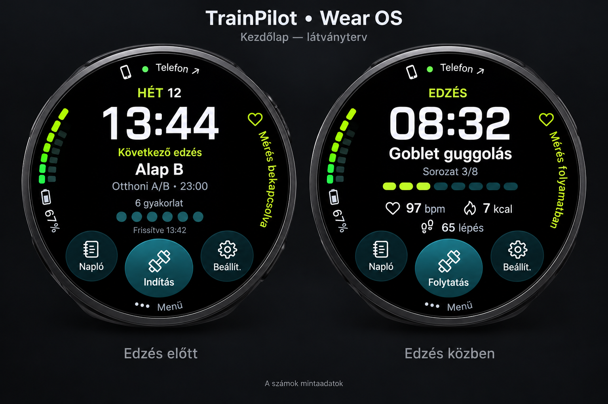

# Wear OS kezdőlap — #170 látványterv

Ez generált látványterv, nem a futó alkalmazás képernyőképe. A számok mintaadatok. A felhasználó sűrű, kör alakú saját számlapját adta referenciának, majd kifejezetten a telefonos appal megegyező ikonokat kért.

## Vizuális irány

- Fekete kijelző, nagy központi adat, finom íves oldalsó feliratok és szegmentált állapotjelző.
- Edzés előtt dátum/idő, következő edzés neve, program és időpont, gyakorlatszám, adatfrissítés ideje.
- Edzés közben eltelt idő, gyakorlat neve, sorozatállapot és előrehaladás, az adott edzéshez tartozó pulzus/kcal, valamint elérhető mozgásadatok.
- Három alsó körgomb: Napló, Indítás/Folytatás, Beállítások/Órás mérések. Külön Telefon és Menü elérés ívesen; az oldalra húzás továbbra is menüt nyit.
- Óra-akkumulátor és mérési állapot a peremen. A kapcsolat és a helyben elérhető programadat külön kezelendő; a korábbi pillanatkép nem bizonyít élő telefonkapcsolatot.

## Az ikonok forrása

A végleges implementáció a `www/index.html` `icons` objektumának eredeti SVG geometriáját használja, nem emojit vagy újrarajzolt alternatív ikonokat:

| Wear cél | Telefonos kulcs |
| --- | --- |
| Edzés indítása/folytatása | `plan` — ferde súlyzó |
| Napló | `history` — spirálos jegyzetfüzet |
| Beállítások | `settings` — fogaskerék |
| Pulzus/mérés | `health` — szív |
| Naptár | `calendar` |

A generált kép ezeket csak közelíti; az alkalmazásban az eredeti SVG-k kerülnek natív vektoros megjelenítésre.

## Megvalósítási korlátok

A mért értékek kizárólag az aktuális edzés azonosítójához illesztve jelenhetnek meg. Mérés nélküli kezdőlapon nincs kitalált pulzus, kcal vagy lépésszám. A szegmentált sor a tervezett/rögzített gyakorlatok vagy sorozatok száma, nem kitalált egészségügyi grafikon. Az akkumulátorérték az óra rendszeréből, a kapcsolatjelzés a tényleges Data Layer kapcsolatból származik majd.

A kisebb kijelzőn és nagyobb rendszerbetűn a tartalom sűrűségét csökkenteni kell; a vezérlők és feliratok maradjanak a körön belül, elkülönített érintési területekkel. A #177-ben elfogadott szerkesztő és többi rövid oldal elrendezése megmarad. A natív megvalósítást kerek kijelzős képernyőképekkel és funkcionális útvonalpróbákkal kell ellenőrizni.

## Elfogadott irány és natív megvalósítás

A felhasználó jóváhagyta a látványterv irányát, a telefonos színek/keretek egyezését és a törlés elérhetőségét kérve. Az aktív edzés törlése a Menü → Edzés törlése pontban marad, a meglévő megerősítéssel; a korábbi edzésnaplót nem törli.

A `WearHomeDashboard` rögzített, görgetés nélküli körnézet. Az indítás/folytatás középen, a Napló és Beállítások körgomb két oldalán, a Telefon és Menü a peremen érhető el. Az ajánlott, aktív, pihenő, félbehagyott, mentésre váró, hibás és adat nélküli állapot külön szöveget/műveletet kap. Az idő és a mérési értékek a kijelzőre mérve illeszkednek; kisebb kijelzőn a kiegészítő sorok csökkennek, nem a körgombok érintési felülete.

A telefonos `makeHomeSnapshot` opcionális `theme` mezője a meglevő választott témakulcsot és palettát továbbítja. Nem írja át a telefonos beállítást, nem olvas DOM-elrendezést, és a korábbi snapshotok is feldolgozhatók. A Wear kiemelései ezt a palettát használják; a keretek/felületek ugyanazzal az sRGB színkeveréssel készülnek, mint a telefon CSS-e. Az új telefonos APK a témaátadáshoz szükséges; a régi telefonos appal a funkciók továbbra is működnek, alap palettával.

A kapcsolatot a NodeClient, az akkumulátort az óra rendszerállapota szolgáltatja. A státuszok a látható Activityben tíz másodpercenként frissülnek. Egy tárolt programadat nem válik kapcsolatbizonyítékká. A Napló és Beállítások visszalépése a kezdőlapra tér vissza.

A funkcionális natív próbák a teljes körgombok láthatóságát, a menügesztusokat, a visszautakat és a törlés megerősítését is ellenőrzik, 160/192/225 dp és normál/150%/200% betűméret mellett. A futásazonosítók és az APK-k lenyomatai a PR-be kerülnek.
